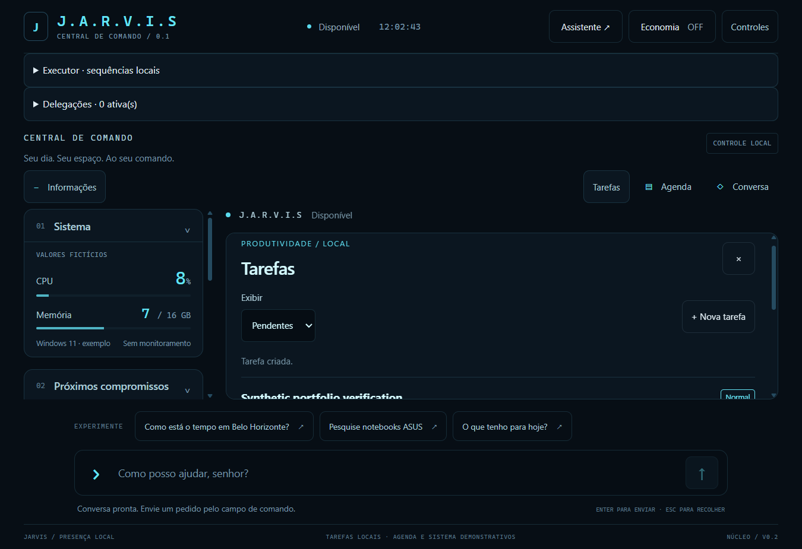
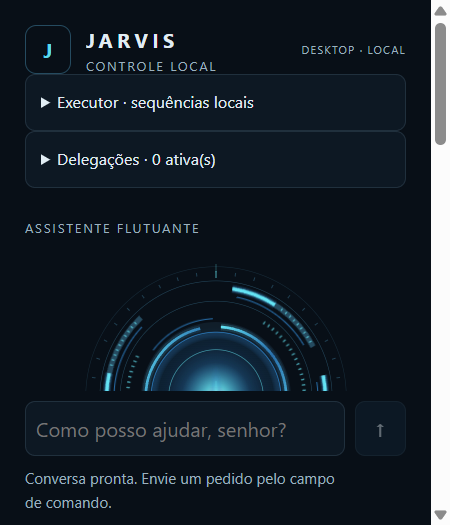

# Windows AI Assistant

**JARVIS** is the internal project codename. This independent project is not affiliated with or endorsed by Marvel or Disney.

A desktop assistant that connects natural-language interaction to typed, locally authorized task operations. Built with **Rust, Tauri 2, React, TypeScript and SQLite**, with Gemini used for interpretation rather than operational authority. The interface and sample prompts are in Brazilian Portuguese.

**Local portfolio candidate based on M3.1 (`902a76c`). Publication is pending. Project-owned code and materials are licensed under MIT; third-party material retains its own terms.**

## Interface

Native Windows WebView captures from an isolated test build; system figures are simulated. No AI provider was called. A synthetic task was created using the Central UI; separate backend tests confirmed persistence after restart. No provider-generated action is shown; see [validation](docs/validation.md).





## Engineering focus

- **Separate interpretation from execution.** Structured model responses are validated locally. The model cannot approve writes, run a shell, or confirm effects on its own.
- **Keep conversation coherent across windows.** The Central and floating assistant share a canonical Rust session with revisions, turn ownership and bounded temporary context.
- **Make task execution inspectable.** Conversational writes require review and scoped approval. Delegated `complete_task` operations use durable plans, attempts and receipts; restart requires explicit review and consent.
- **Evaluate boundaries, not only happy paths.** Tests cover stale revisions, ambiguity, authorization, interruptions and recovery. Real-provider evidence is reported separately from fixtures.

## Demonstrated capabilities

| Capability | Boundary |
| --- | --- |
| General conversation and corrections across windows | Bounded temporary context; no persistent personal memory |
| Create, query, update, complete and delete local tasks | Conversational writes pass local authorization; manual controls also exist |
| Sequential completion of selected tasks | Only `complete_task` is delegable; no automatic restart or rollback of confirmed effects |
| Weather lookup and opening a Google search | Opening results does not mean reading or researching them |
| Offline task management | Model interpretation and weather require network access |

[Architecture](docs/architecture.md) · [Validation](docs/validation.md) · [Synthetic demo script](docs/demo.md) · [Rights and attribution](THIRD_PARTY_NOTICES.md)

## Run the frontend preview

Requires Node.js **22.12+** and npm. From this directory:

```sh
npm ci
npm test
npm run build
npm run dev
```

Open `http://127.0.0.1:1420`, or `http://127.0.0.1:1420/?window=assistant` for the floating layout. This preview does not invoke desktop commands, call Gemini or persist tasks. It is not a native integration test.

## Run the desktop app on Windows 11

Use a native Windows checkout with Node.js 22.12+, stable Rust MSVC, Microsoft C++ Build Tools with Desktop development with C++, Windows SDK and WebView2. See the [Tauri prerequisites](https://v2.tauri.app/start/prerequisites/). Keep Windows and Linux dependencies/build directories separate.

```powershell
npm ci
npm test
npm run build
cargo test --manifest-path src-tauri/Cargo.toml --locked --lib
npm run tauri dev
```

For native compilation without an installer: `npm run tauri build -- --no-bundle`. Installer packaging is disabled. Do not point demonstration runs at an existing personal installation: the unchanged application identifier is `com.jarvis.desktop.poc`, and its real database is `%LOCALAPPDATA%\com.jarvis.desktop.poc\tasks.sqlite3`. Use a separate Windows user/profile with synthetic data. This preparation does not launch the application.

Gemini interpretation requires `GEMINI_API_KEY` supplied privately to the Rust process environment. Never put it in frontend variables, source, screenshots or logs. Without it, use manual task controls; remote interpretation reports an error. No credential is needed for unit tests or the web preview. Supplying a key and sending a message can incur provider charges; this repository does not grant a free-tier or availability guarantee.

## Validation and limitations

Historical M3.1 evidence records a 403-test TypeScript baseline, later targeted revalidation (112 executions, not additive unique coverage), 114 native Windows Rust tests, and 21 aggregate real Gemini calls. These are different boundaries and configurations, not a single end-to-end score. See [validation and acceptance provenance](docs/validation.md) for caveats and this preparation's checks.

The product uses a 25-second remote timeout, at least six seconds between calls and a limit of 20 calls per process. Evaluation-only builds used a 60-second timeout; that change is not in this candidate. Latency and semantic reliability remain variable. No voice, arbitrary computer automation, source-reading research, persistent personal memory, or operational OpenAI integration is claimed. There is no production-readiness claim.

M3.2 is excluded from this source selection. Its separate memory experiments documented 72.7% capture coverage on an adjusted development corpus versus 8.3% on a blind holdout; automatic capture stayed blocked. This is evidence of a rejected generalization hypothesis, not a delivered capability.

Project-owned code and materials are distributed under the [MIT license](LICENSE). Third-party components and data remain subject to their own licenses and terms. See [rights and attribution](THIRD_PARTY_NOTICES.md).
