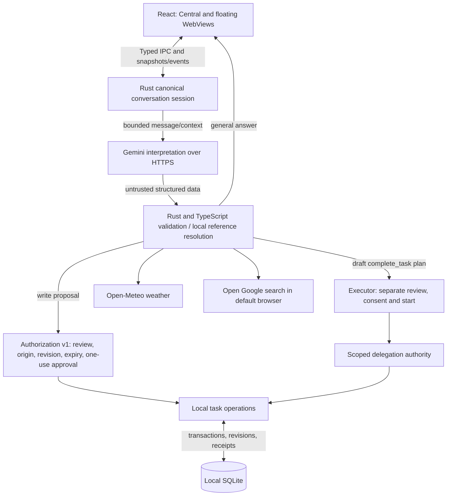

# Architecture

`src-tauri/Cargo.toml` selects `src/authorized-main.rs` as the executable; `src/main.rs` is a frozen earlier reference. `authorization-tests.rs` is the Rust test library. `delegation.rs` includes `executor.rs`; inspect both for durable execution.

`conversation.rs` owns temporary history, revisions and exclusive turn state. `assistant_intelligence.rs` and `habitual_intelligence.rs` build and validate interpretation requests. `authorization.rs`, `tasks.rs`, `delegation.rs` and `executor.rs` enforce operational boundaries. `useConversation.ts` and the conversation reducers coordinate presentation and local resolution; frontend state never grants backend authority.

The provider sees the current message and bounded relevant context, including recent general conversation and selected correction context. It does not receive an unrestricted database dump. Task data and operational grants remain local. Search and weather cross separate network boundaries; search opens a browser and does not ingest results.

Hiding/restoring a window preserves the session; process exit discards conversational context. SQLite keeps task and execution state. Interrupted plans require new review and consent. Confirmed task effects are not automatically rolled back.
